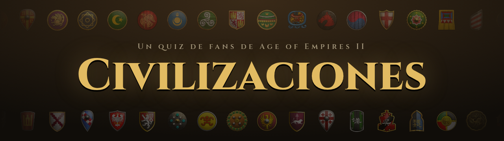
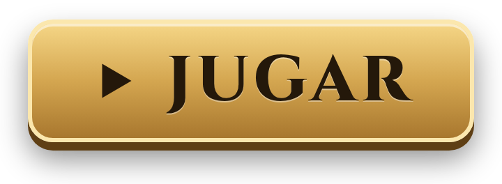
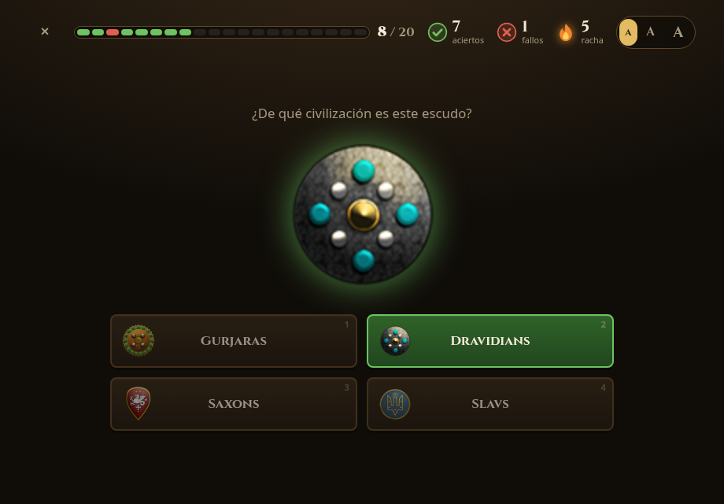
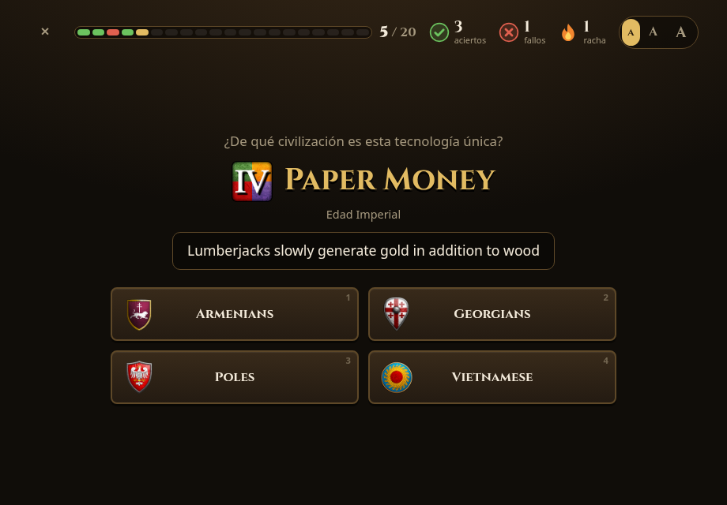
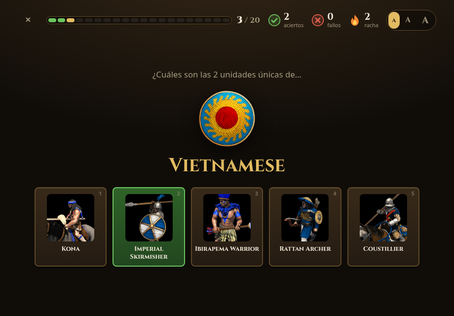
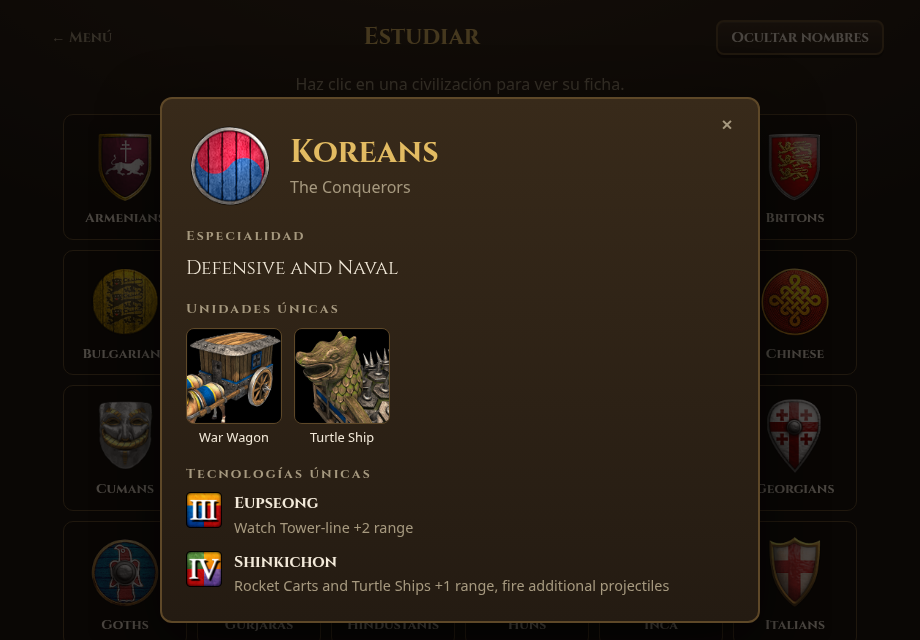

### ¿Cuánto sabes de las civilizaciones de Age of Empires II?

Reconoce sus escudos y aprende en qué destaca cada una, sus unidades únicas y sus tecnologías únicas.

Gratis, en el navegador y sin registrarse.

## Modos de juego

<table>
  <tr>
    <td width="50%" align="center" valign="top">
       
      <b>Escudos</b> 
      Escudo → nombre, nombre → escudo o una mezcla de los dos
    </td>
    <td width="50%" align="center" valign="top">
       
      <b>Tecnología única</b> 
      Lees qué hace y eliges de qué civ es
    </td>
  </tr>
  <tr>
    <td align="center" valign="top">
       
      <b>Unidades únicas</b> 
      De qué civ es cada unidad y qué unidades tiene cada civ
    </td>
    <td align="center" valign="top">
       
      <b>Estudiar</b> 
      La ficha de cada civ: especialidad, unidades y tecnologías
    </td>
  </tr>
</table>

Y además, **Especialidad**: en qué destaca cada civ (caballería, arqueros, naval…).

## Cómo se juega

- **Con el ratón**: haz clic en la respuesta. Si fallas, verás la buena antes de seguir.
- **Dificultad**: de 4 opciones a todas las civs. En *Difícil* entran las de su misma expansión, que son las que más se parecen.
- **Rondas** de 10, 20, todas o infinitas. Lo que más falles sale más a menudo, y al final puedes repasar tus fallos.
- **Nombres** en inglés o en español, y las civs de *Chronicles* si quieres.
- **Atajos**: 1-9 para responder, Enter para seguir, + y − para el tamaño de las opciones, Esc para salir.

Tu progreso se guarda en tu navegador. También funciona sin conexión: descarga el repositorio y abre `index.html`.

## Créditos

Un proyecto de fans, gratuito y sin ánimo de lucro. Los escudos, los iconos y los textos son de Age of Empires II: Definitive Edition, y la fuente es [Cinzel](https://github.com/NDISCOVER/Cinzel) (SIL Open Font License).

Age of Empires II: Definitive Edition © Microsoft Corporation. Civilizaciones was created under Microsoft's "<a href="https://www.xbox.com/en-US/developers/rules">Game Content Usage Rules</a>" using assets from Age of Empires II: Definitive Edition, and it is not endorsed by or affiliated with Microsoft.
